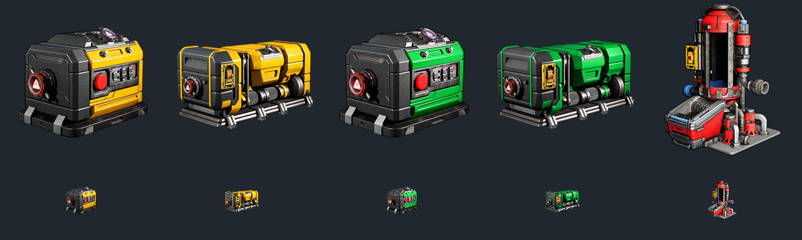

# Caretaker Energy

Vier zusätzliche Diesel- und Methan-Stromgeneratoren **und eine stationäre Benzinraffinerie in einer gemeinsamen Mod** für *The Last Caretaker*. Die vorhandenen Benzingeneratoren, die tragbare Benzinraffinerie und die Dieselraffinerie bleiben verfügbar.

[Download auf GitHub](https://github.com/C1yHAX/caretaker-energy/releases/tag/v1.0.0) · [Download auf GitLab](https://gitlab.com/c0d1ngf1eber/caretaker-energy/-/releases/v1.0.0)

## Inhalt und Balance

| Neues Gerät | Freischaltstufe | Punkte | Leistung / Verarbeitung | Brennstoffbedarf pro Spielstunde |
|---|---:|---:|---|---:|
| Tragbarer Dieselgenerator | 8 | 2 | 10 kW | 1.500 Diesel |
| Großer Dieselgenerator | 17 | 3 | 33 kW | 4.500 Diesel |
| Tragbarer Methangenerator | 19 | 2 | 10 kW | 20.000 Methan |
| Großer Methangenerator | 21 | 3 | 33 kW | 60.000 Methan |
| Stationäre Benzinraffinerie | 10 | 2 | 16.000 Benzin pro Stunde bei 3 kW | 5.000 organische Umwandlungseinheiten pro Stunde |

Die Mengen sind die internen Spielwerte. Diesel ist effizienter, benötigt zusätzliche Pumpen und Rahmen und wird nach dem jeweiligen Benzingenerator freigeschaltet. Methan folgt der Gasproduktion: der tragbare Generator auf Stufe 19 mit dem Methan-Extraktor, der große auf Stufe 21. Die stationäre Raffinerie folgt deutlich nach der tragbaren Raffinerie auf Stufe 5.

Diesel verwendet Treibstoffschläuche, Methan Gasleitungen. Der Methaneingang ist ausdrücklich auf 72.000 Einheiten pro Stunde ausgelegt. Strom- und CO₂-Ausgänge entsprechen den Vorlagen. Ein Methan-Extraktor mit **zwei** tragbaren Generatoren liefert rechnerisch etwa 18 kW brutto und 8 kW netto; ein einzelner tragbarer Generator deckt lediglich die 10 kW Eigenverbrauch des Extraktors. Der Sabatier-Kreislauf bleibt verlustbehaftet.

Die neue Benzinraffinerie nimmt organisches Material ohne Gewichtszulassungsgrenze auf. Dies ändert weder das Umwandlungsverhältnis noch den Benzinpuffer. Das separate Paket **Caretaker Refinery Intake** hebt dieselbe Grenze auch an den beiden bestehenden Biomasse-Raffinerien auf; es gehört zum vollständigen lokalen Modpack.

Die Gehäuse sind nach Brennstoff eingefärbt: **Benzin rot, Diesel gelb, Methan in gedämpftem Graugrün wie die Methantanks**. Sechs eigene Materialinstanzen verwenden die vorhandenen Shader. Zwei eigene Farbtexturen färben die Lackflächen der Raffinerie rot; ihre Kompression, 13 Mip-Stufen und das virtuelle Textur-Streaming bleiben erhalten. Normalen- und Oberflächentexturen stammen weiterhin aus dem Spiel. Metall, Verschleißspuren und mechanische Details bleiben erkennbar; die Farben der ursprünglichen Geräte werden nicht überschrieben. Dafür ist kein dauerhaft laufendes Skript nötig.

Modelle stammen aus den Spielvorlagen. Fünf eigene farbige Icons zeigen Diesel gelb, Methan in gedämpftem Graugrün wie die Methantanks und die Benzinraffinerie rot. Sie sind sowohl an die Gegenstände als auch an ihre Freischaltungen gebunden. Die Original-Icons des Spiels werden nicht überschrieben. Die Iconvarianten wurden mit KI-Bildbearbeitung aus den Originalsymbolen erstellt und als transparente 256×256-UI-Texturen integriert. Namen, Brennstoffanschlüsse, Umwandlungen und Skills sind eigenständig. Gegenstandsgewicht: 0, passend zum ursprünglichen Modpack. Die Modtexte sind deutsch, auch bei anders eingestellter Spielsprache.

## Installation

Zielversion: **0.10.0.653173, Steam-Build 25982825**. Andere Spielversionen sind nicht bestätigt.

1. [AssetBridge von NotLazy](https://www.nexusmods.com/thelastcaretaker/mods/225) installieren; dieses Paket wurde mit **0.4.0** gebaut und geprüft. AssetBridge wird separat vom Autor bezogen.
2. Spiel und Modmanager schließen. Aus dem Release die Datei `Caretaker-Energy-1.0.0.zip` herunterladen und entpacken.
3. Den im ZIP enthaltenen Ordner `Voyage` in den Spielordner kopieren. Ergebnis: `Voyage/Content/Paks/~mods/CaretakerEnergy/` enthält `.pak`, `.utoc`, `.ucas` und `.tlcaddon.json`. Alle vier Dateien gehören zusammen.
4. Bei einem Upgrade die früheren Ordner **CaretakerFuelGenerators** und **CaretakerPetrolRefinery** vorher aus dem Paks-Verzeichnis herausnehmen. Nicht zusammen mit dem neuen Paket laden. Ein optionaler PowerShell-Installer liegt im Repository; er ist kein Bestandteil des Mod-ZIPs.

5. Spiel starten. AssetBridge registriert die fünf Items und fünf Skills. Die Gesamtzahl im Log hängt von weiteren installierten Addons ab.

Die bisherigen Item-, Blueprint- und Skill-Pfade bleiben beim Upgrade erhalten. Die ZIP enthält keine Spielstände, keine fremden Mods und keinen AssetBridge-Cache. Das vollständige Modpack enthält diese gemeinsame Mod bereits; dort nicht noch einmal installieren.

## Prüfung und bekannte Grenzen

Die 30 Assets einschließlich fünf eigener Icontexturen wurden vollständig gelesen, binär verlustfrei zurückgeschrieben und nach dem Packen mit unveränderten Exportdaten wieder extrahiert. Der Container ist verifiziert; die zehn Registrierungen sind eindeutig. Gegen die vorhandenen Addons wurden Paketpfade auf Überschneidungen geprüft.

**Version 1.0.0 ist der Erstrelease.** Zusätzlich zur statischen Prüfung wurden alle fünf Geräte in einer leeren Testwelt der Spielengine erzeugt und ihre Materialzuordnungen geprüft. Die Gehäusefarben wurden in Renderaufnahmen aus der Engine kontrolliert. Die unbegrenzte organische Aufnahme wurde an der geladenen Raffinerievorlage bestätigt. AssetBridge hat alle zehn Energy-Einträge im vollständigen Modpack erfolgreich registriert. Alle fünf Icontexturen wurden in der Spielengine geladen, in großer und kleiner Darstellung gerendert und ihre Verknüpfung mit allen fünf Items und fünf Skills bestätigt. Herstellung, Betrieb unter Last und Speichern/Laden sind für diese kombinierte Fassung noch nicht durch einen vollständigen Spieltest bestätigt. Bitte neue Versionen zunächst mit einer Kopie des Spielstands prüfen.

Vor einer Deinstallation platzierte Geräte abbauen und Gegenstände aus Inventaren/Containern entfernen. Gespeicherte Skills verlieren ohne die Mod ihr Ziel. Die Installation selbst bearbeitet keine Spielstände.

## Quellcode und Änderungen

`generators-spec.json` und `refinery-spec.json` enthalten Balance, Rezepte, Freischaltungen und Texte; `appearance.json` beschreibt Farben und Materialzuordnungen. `icons.json` enthält die Zuordnung der fünf farbigen Symbole zu Items und Skills; die PNG-Quellen liegen unter `assets/icons/`. Die C#-Builder erzeugen eigene Assets aus den lokal vorhandenen Spielvorlagen. Die Basisspiel-Assets und das Mapping werden nicht im Quellcode-Repository mitgeliefert. Siehe [BUILDING.md](BUILDING.md) und [CHANGELOG.md](CHANGELOG.md).

Eigener Build- und Installationscode: MIT, siehe [LICENSE](LICENSE). Spielmodelle, Symbole und daraus abgeleitete gekochte Assets gehören weiterhin ihren jeweiligen Rechteinhabern; die Code-Lizenz erteilt daran keine eigenständigen Rechte. *The Last Caretaker* wird von Channel37 entwickelt. Dies ist eine inoffizielle Mod.

## English

Adds portable and large diesel/methane electric generators plus a stationary petrol refinery in **one additive mod**. Unlock levels: diesel 8/17, methane 19/21, refinery 10. Housing colors: red petrol, yellow diesel, muted grey-green methane matching the methane tanks. Existing game generators and refineries remain available. Requires the game build above and AssetBridge; download it separately from the linked author page. Install all four package files under `Voyage/Content/Paks/~mods/CaretakerEnergy`. Remove the previous separate CaretakerFuelGenerators/CaretakerPetrolRefinery containers when upgrading; saved asset identities are retained. In-game labels are German. Five custom icons match the red/yellow/muted grey-green housing colors in item and skill menus. Version 1.0.0 is the first release with static checks and successful spawning and material rendering in the game engine; a full gameplay/save-reload test is still pending.

## Inhalt des Mod-Downloads

Das Release-ZIP enthält ausschließlich die zum Betrieb benötigten Moddateien in der `Voyage`-Ordnerstruktur. Anleitung, Änderungslisten, Lizenztexte, Drittanbieterhinweise, Entwicklungswerkzeuge und Prüfberichte bleiben im Repository bzw. auf der Release-Seite. Sie werden nicht mit ins Mod-ZIP gepackt. Die Prüfsumme ist ein separater Download. Version bleibt **1.0.0**.

Zur Paketierung eines geprüften Builds: `python tools/package_release.py --package <Buildordner>/package`. Die vier Dateien werden gegen `Dateien.json` geprüft. Neue Builds erfordern einen bewusst aktualisierten Dateikatalog. Das lokale vollständige Modpack wird mit `python tools/package_modpack.py --source <Stagingordner> --output <Ziel.zip>` ebenfalls ohne Dokumentation gepackt.
